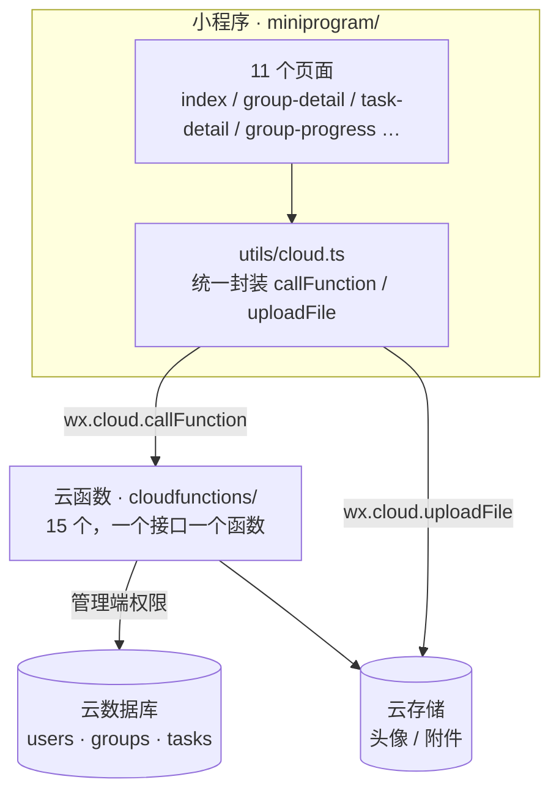

# GroupWork · 课程小组协作小程序

> 把「小组作业怎么分工」从口头商量，变成**可认领、可追踪、可留痕**的流程。

微信小程序（原生 TypeScript）＋ 微信云开发。前端不直接读写数据库，所有数据都经过云函数，权限可控、逻辑集中。

<!-- 建议放 1 张 30 秒演示 GIF，README 第一屏决定别人要不要往下看 -->
<!--  -->

---

## 为什么做这个

课程小组作业的典型流程是：组长在群里问「谁做哪部分」，没人认领，最后靠指派，分配是否公平说不清，进度只能靠追问。

问题不在于「没人干活」，而在于**分工过程没有载体**：任务没有状态、责任没有归属、进度不可见、出了问题没有记录。

GroupWork 把这件事做成一条有状态的流程：

```
建组 → 邀请加入 → 发布任务 → 成员认领 → 提交 → 进度看板 → 结束归档
```

---

## 功能

| 模块 | 能力 |
|---|---|
| 小组 | 创建小组、通过邀请码加入、查看成员与角色、结束小组 |
| 任务 | 发布任务（标题/描述/截止时间/优先级）、成员自主认领、组长指派、提交任务 |
| 进度 | 小组进度看板：每人任务数、完成率、逾期情况 |
| 协作 | 会议时间约定、活动日志（谁在什么时候做了什么） |
| 个人 | 个人资料与头像、历史小组 |

---

## 架构



**关键设计**：客户端不直连数据库。所有集合的读写权限设为「仅云函数可读写」，业务规则（谁能认领、谁能结束小组）只写在云函数里，避免前端被绕过。

---

## 快速开始

1. 用**微信开发者工具**导入本目录（不是 `miniprogram/` 子目录）。
2. AppID：填你自己的小程序 AppID，或直接选「测试号」。
3. 开通云开发 → 新建环境 → 复制**环境 ID**，填到 `miniprogram/app.ts`：

   ```ts
   wx.cloud.init({
     env: 'your-cloud-env-id',   // ← 改成你的环境 ID
     traceUser: true,
   })
   ```

4. 右键 `cloudfunctions` 目录 → **上传并部署：云端安装依赖**（15 个云函数）。
5. 云开发控制台 → 数据库 → 新建集合 `users`、`groups`、`tasks`，权限均设为**仅云函数可读写**（详见 [`docs/database-permissions.md`](docs/database-permissions.md)）。
6. 编译运行。

> 仓库里不含 `appid` 和云环境 ID，需要你自己填——这是有意为之。

---

## 目录结构

```
.
├── miniprogram/            # 小程序前端（TypeScript）
│   ├── pages/              #   11 个页面
│   ├── components/         #   自定义导航栏
│   ├── utils/cloud.ts      #   云函数调用 / 文件上传封装
│   └── app.ts              #   全局初始化（云开发环境）
├── cloudfunctions/         # 15 个云函数（每个接口一个）
├── typings/                # 微信小程序类型定义
├── docs/
│   ├── architecture.md     # 三层架构与数据流转
│   ├── database-permissions.md
│   └── prd.md              # 需求文档：用户故事 / 异常流程 / 埋点
├── project.config.json
└── package.json
```

---

## 数据模型

| 集合 | 说明 | 关键字段 |
|---|---|---|
| `users` | 用户资料 | `_id`(openid) · `nickname` · `avatarUrl` |
| `groups` | 小组 | `name` · `inviteCode` · `ownerId` · `memberIds` · `status` |
| `tasks` | 任务 | `groupId` · `title` · `assigneeId` · `status` · `dueAt` |

读写全部经由云函数：`createGroup` / `joinGroup` / `createTask` / `claimTask` / `assignTask` / `submitTask` / `getGroupProgress` 等。

---

## 设计取舍

**为什么用云函数而不是客户端直连数据库？**
分工规则（谁能认领、认领后能不能改、组长能否强制指派）属于业务规则。放在客户端意味着任何人都能绕过。放在云函数里，规则只有一份，且不依赖前端自觉。

**为什么「认领」和「指派」是两条路径？**
调研发现，纯指派会导致参与感低，纯认领会导致没人接难题。两种方式并存，由组长在「公平」和「兜底」之间选择。

**为什么要有活动日志？**
小组协作的矛盾大多来自「我以为你做了」。日志不是监控，是让责任可回看。

---

## 已知限制

- 未做消息订阅通知，截止时间提醒需要用户主动查看。
- 单小组人数上限写在前端校验里，云函数侧未做强校验。
- 未接入 CI，云函数依赖手动上传部署。

---

## License

MIT
